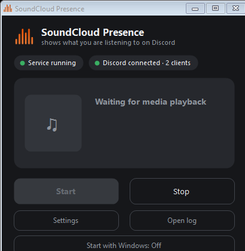
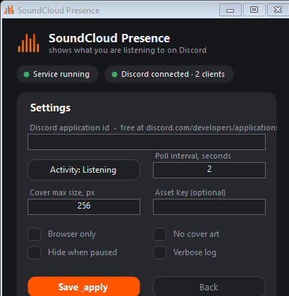

# SoundCloud Presence

A tiny Windows app that puts whatever you're listening to on your Discord
profile — title, artist, cover art, the works.

It reads the Windows media session (the same thing the volume button in your
taskbar shows), so it works with **SoundCloud and YouTube in any browser**, and
also with desktop players like Spotify, TIDAL, VLC or foobar2000. No Discord
SDK, no dependencies, nothing to install — you just paste in one free
application id once (two minutes, it's step 4 below).

And if you have more than one Discord open at a time — Stable + PTB + Canary,
or two accounts in separate instances — it sends the activity to every one of
them simultaneously.



## Why

I listen to a lot of SoundCloud sets in the browser and wanted friends to see
what's playing without asking. Browser extensions for this felt like way too
much machinery, so instead this is just a small tray app and a PowerShell
script that talk to Discord over its own local named-pipe protocol. If you
can play something on Windows and Windows shows it as "now playing", this can
put it on Discord.

## Get started

1. Grab `SoundCloudPresence-<version>-windows.zip` from the
   [latest release](../../releases), unpack it anywhere.
2. Make sure the Discord **desktop app** is running (the browser version won't
   work — the script talks to the local app).
3. In Discord: Settings → Activity Privacy → enable
   *"Display current activity as a status message"*. Once.
4. Get your own application id (free, a minute): on
   [discord.com/developers/applications](https://discord.com/developers/applications)
   click *New Application*, name it whatever you like (that name can show up
   on your profile card), copy the big **Application ID**.
5. Run `SoundCloudPresence.exe`, open **Settings**, paste the id, hit
   *Save & apply*, press Start, play something. Your track shows up under
   Activities.

Click *"Start with Windows"* once and you'll never think about it again.

## Settings

The app has a **Settings** page, so you never have to open a file by hand —
it writes to `config.txt` next to the exe and restarts the service when you
hit *Save & apply*. Only `CLIENT_ID` is required (see step 4 above), every-
thing else is optional:



| Option | Default | Description |
|--------|---------|-------------|
| `CLIENT_ID` | – | your Discord application id — the one required setting |
| `BROWSER_ONLY` | `false` | ignore anything that isn't a browser |
| `NO_COVER` | `false` | skip cover uploads, text only |
| `HIDE_WHEN_PAUSED` | `false` | hide activity while paused |
| `ACTIVITY_TYPE` | `2` | 2 = Listening, 0 = Playing, 3 = Watching |
| `POLL_SECONDS` | `2` | fallback timer (song changes are event-driven anyway) |
| `ASSET_KEY` | – | optional image asset from the Discord Developer Portal |
| `COVER_MAX_SIZE` | `256` | max cover size in px |
| `VERBOSE` | `false` | extra logging |

## How it works

`SoundCloudPresence.exe` is a WinForms tray app that starts, stops and displays
the status of `SoundCloudPresence.ps1`, which does the actual work. The script
subscribes to Windows SMTC change events (so a new song is detected basically
instantly) and pushes the track to Discord over `\\.\pipe\discord-ipc-*` — the
same local protocol the official RPC libraries use, just without the library.
Every running Discord client owns one of these pipes, so the script connects
to all of them and broadcasts — all your accounts see it at once.

Cover art: Discord only accepts images from URLs, so the script shrinks the
thumbnail Windows gives us and uploads it to a free image host (uguu.se, with
tmpfiles.org and catbox.moe as fallbacks). The URL lives only as long as the
track does. Set `NO_COVER=true` if you'd rather skip that entirely.

## Building from source

Windows only, and honestly only if you enjoy that sort of thing — the release
zip is prebuilt. You need nothing beyond stock Windows:

```
powershell -ExecutionPolicy Bypass -File .\build.ps1
```

That compiles the C# GUI with the .NET Framework compiler that ships with
Windows, assembles `dist\`, and produces a zip ready to attach to a release.

The files:

| File | What it is |
|------|------------|
| `src/SoundCloudPresence.cs` | the tray app / GUI |
| `src/SoundCloudPresence.ps1` | the service: SMTC watching, cover upload, Discord IPC |
| `config.txt` | the settings shipped with the release |
| `build.ps1` | one-script build, see above |

## Troubleshooting

- **Nothing shows up in Discord** → that Activity Privacy toggle from step 3
  is the usual suspect. Also: check your profile card, not your custom status.
- **Cover missing on some tracks** → not every player exposes artwork through
  the Windows media session, and the image hosts go down now and then. The
  text always shows regardless.
- **Player not detected** → it has to report to the Windows media controls
  (most do). `%TEMP%\SoundCloudPresence.log` says what was seen, there's an
  *Open log* button for it.

## Notes

- The activity only exists while the service runs — that's how Discord RPC
  works, not an oversight.
- Requires Windows 10/11 (the stock PowerShell 5.1 is enough) and the Discord
  desktop app.
- I kept the MIT license on purpose: an open-source repo without a license is
  legally "all rights reserved", which defeats the point of posting it here.
  Do whatever you want with the code.
